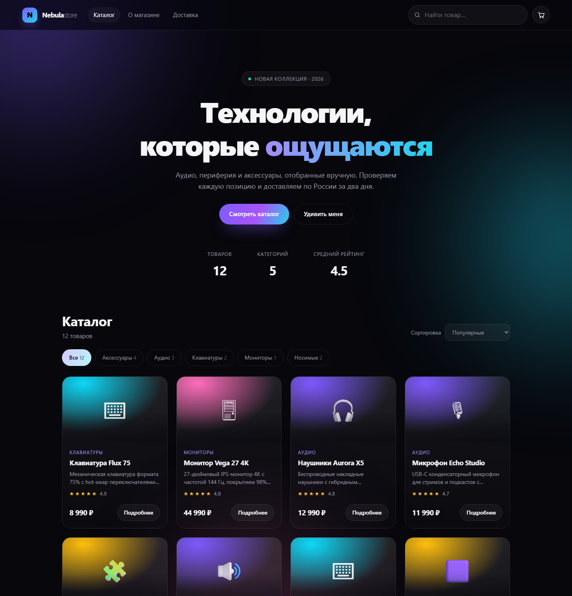
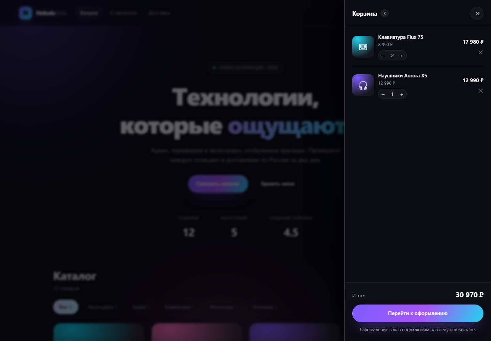
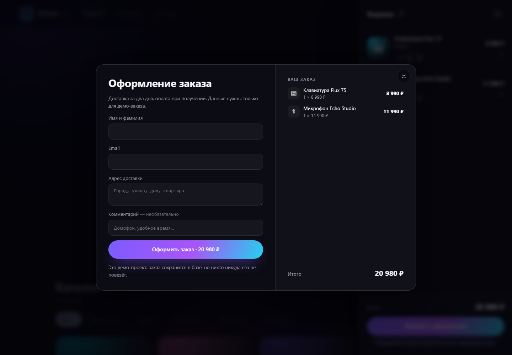
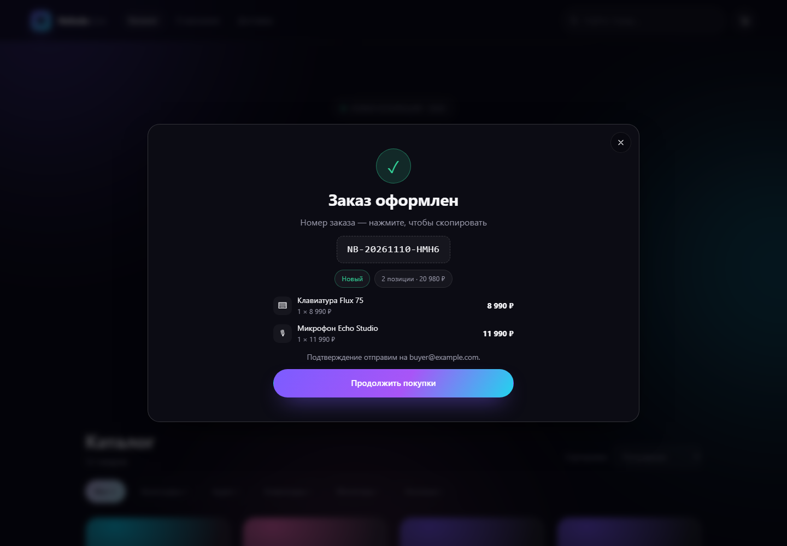

# Nebula Store

[](https://github.com/Daniil2022Ri/nebula-store/actions/workflows/ci.yml)

Демо-интернет-магазин электроники: REST API на **Java 21 + Spring Boot 3.5** и витрина на
чистом HTML/CSS/JS без сборщика.



> **Статус: этап 3 — каталог, корзина и оформление заказа.**
> Готовы доменная модель, REST API каталога, витрина, серверная корзина и checkout
> со снимком цен и списанием стока. Админка заказов — следующий шаг, она в
> [дорожной карте](#дорожная-карта).

## Что уже работает

- **Каталог** из 12 демо-товаров в пяти категориях; данные лежат в H2 и засеиваются при первом старте.
- **Поиск** по названию, описанию и категории — без учёта регистра и с дебаунсом в UI.
- **Фильтр по категориям** и пять режимов сортировки: популярные, дешевле, дороже, по рейтингу, по названию.
- **Корзина** на сервере: браузер хранит только идентификатор, цены и остатки
  пересчитываются по каталогу при каждом запросе, количество ограничено складом.
- **Оформление заказа**: транзакционный checkout со снимком цен, списанием стока,
  номером вида `NB-20261110-6GQ8` и страницей подтверждения.
- **REST API** с валидацией и ошибками в формате RFC 7807 (`application/problem+json`).
- **Витрина**: hero-блок со статистикой, чипсы категорий, адаптивная сетка карточек,
  скелетоны загрузки, пустое состояние, модалка товара с диплинком `#product-<id>`,
  шторка корзины со степперами, бейджем и итоговой суммой, форма оформления, тосты.
- **Тесты**: 27 штук — интеграционные на MockMvc и юнит-тесты сидера.
- **CI**: сборка и тесты на GitHub Actions при каждом пуше.

Корзина — шторка справа с пересчётом суммы и ограничением по остаткам:



Оформление заказа: форма с составом заказа и подтверждение с номером.





## Стек

| Слой          | Технологии                                                        |
|---------------|-------------------------------------------------------------------|
| Язык          | Java 21 (проект собирается и на JDK 25)                            |
| Бэкенд        | Spring Boot 3.5 — Web MVC, Data JPA, Validation, Actuator          |
| БД            | PostgreSQL 18 (H2 — только для тестов, in-memory)                  |
| Фронтенд      | Vanilla JS (ES2022), CSS custom properties, `<dialog>`, без npm     |
| Сборка        | Maven 3.9 + Maven Wrapper                                          |
| Тесты         | JUnit 5, AssertJ, MockMvc, Hamcrest                                |

## Быстрый старт

Нужен JDK 21 или новее и локальный PostgreSQL на `localhost:5432`.

```bash
# 1. создайте базу (один раз)
psql -U postgres -c "CREATE DATABASE nebula"
# или: createdb -U postgres nebula

# 2. положите пароль в локальный конфиг (файл в .gitignore)
cp src/main/resources/application-local.yml.example src/main/resources/application-local.yml
#    и отредактируйте пароль в application-local.yml

# 3. запустите
git clone https://github.com/Daniil2022Ri/nebula-store.git
cd nebula-store
./mvnw spring-boot:run          # Windows: mvnw.cmd spring-boot:run
```

Пароль можно не хранить в файле, а передать переменной окружения:

```bash
NEBULA_DB_PASSWORD=secret ./mvnw spring-boot:run
```

| Что                | Адрес                                      |
|--------------------|--------------------------------------------|
| Витрина            | <http://localhost:8080>                    |
| API                | <http://localhost:8080/api/products>       |
| Health             | <http://localhost:8080/actuator/health>    |
| База               | `jdbc:postgresql://localhost:5432/nebula`  |

Схему (`products`, `orders`, `order_items`) Hibernate создаёт сам при старте
(`ddl-auto: update`), демо-каталог засеивается, если таблица товаров пуста.

Собрать исполняемый jar и запустить его:

```bash
./mvnw clean package
java -jar target/nebula-store-1.0.0.jar
```

Чтобы начать с чистого каталога, остановите приложение и выполните
`DROP SCHEMA public CASCADE; CREATE SCHEMA public;` в базе `nebula` (или `DROP DATABASE nebula`).

Тесты работают на H2 в памяти и PostgreSQL не требуют: `./mvnw test`.

## API

| Метод | Путь                | Параметры                                             | Описание                        |
|-------|---------------------|-------------------------------------------------------|---------------------------------|
| GET   | `/api/products`     | `category`, `q`, `sort` (`popular` по умолчанию)      | Список активных товаров         |
| GET   | `/api/products/{id}`| —                                                     | Один товар или `404`            |
| GET   | `/api/categories`   | —                                                     | Категории с количеством товаров |
| GET   | `/api/cart`         | заголовок `X-Cart-Id`                                 | Корзина (создаётся пустой)      |
| POST  | `/api/cart/items`   | `{ "productId": 1, "quantity": 2 }`                   | Добавить товар к текущему количеству |
| PUT   | `/api/cart/items/{productId}` | `{ "quantity": 3 }`                          | Задать количество (`0` — удалить) |
| DELETE| `/api/cart/items/{productId}` | —                                            | Удалить позицию                 |
| DELETE| `/api/cart`         | —                                                     | Очистить корзину                |
| POST  | `/api/orders`       | заголовок `X-Cart-Id` + данные покупателя             | Оформить заказ (`201` + `Location`) |
| GET   | `/api/orders/{code}`| —                                                     | Заказ по номеру (регистр не важен) |

Корзина идентифицируется непрозрачным id: клиент присылает его в заголовке `X-Cart-Id`,
а если заголовка нет — сервер создаёт новую корзину и возвращает её `id` в теле ответа.
Каждый вызов возвращает полный снимок корзины, поэтому UI просто перерисовывает ответ.

Примеры:

```bash
curl "http://localhost:8080/api/products?q=клавиатура"
curl "http://localhost:8080/api/products?category=Аудио&sort=price_desc"
curl "http://localhost:8080/api/categories"

CART=$(curl -s http://localhost:8080/api/cart | jq -r .id)
curl -s -X POST http://localhost:8080/api/cart/items \
     -H "X-Cart-Id: $CART" -H "Content-Type: application/json" \
     -d '{"productId":1,"quantity":2}'
curl -s -X PUT http://localhost:8080/api/cart/items/1 \
     -H "X-Cart-Id: $CART" -H "Content-Type: application/json" -d '{"quantity":5}'

curl -s -X POST http://localhost:8080/api/orders \
     -H "X-Cart-Id: $CART" -H "Content-Type: application/json" \
     -d '{"name":"Даниил","email":"buyer@example.com","address":"Москва, ул. Тверская, 7"}'
```

Ответ `POST /api/orders` (`201 Created`, заголовок `Location: /api/orders/NB-…`):

```json
{
  "id": 1,
  "code": "NB-20261110-6GQ8",
  "status": "NEW",
  "statusTitle": "Новый",
  "total": 25980.00,
  "createdAt": "2026-11-10T10:15:32.411Z",
  "customerName": "Даниил",
  "email": "buyer@example.com",
  "address": "Москва, ул. Тверская, 7",
  "comment": null,
  "itemCount": 2,
  "items": [
    {
      "productId": 1,
      "slug": "aurora-x5",
      "name": "Наушники Aurora X5",
      "icon": "🎧",
      "unitPrice": 12990.00,
      "quantity": 2,
      "lineTotal": 25980.00
    }
  ]
}
```

Оформление заказа транзакционное: остатки проверяются и списываются вместе с сохранением
заказа, а цены копируются в позиции заказа. Если товара не хватило — заказ не создаётся,
корзина остаётся нетронутой.

Ответ `GET /api/cart`:

```json
{
  "id": "6a4d1f5e-7c1e-4a52-9a4e-3c0f0d2b9a11",
  "items": [
    {
      "productId": 1,
      "slug": "aurora-x5",
      "name": "Наушники Aurora X5",
      "category": "Аудио",
      "icon": "🎧",
      "unitPrice": 12990.00,
      "quantity": 2,
      "lineTotal": 25980.00,
      "stock": 14,
      "inStock": true
    }
  ],
  "itemCount": 2,
  "subtotal": 25980.00
}
```

Ответ `GET /api/products/{id}`:

```json
{
  "id": 1,
  "slug": "aurora-x5",
  "name": "Наушники Aurora X5",
  "description": "Беспроводные накладные наушники с гибридным шумоподавлением…",
  "category": "Аудио",
  "price": 12990.00,
  "stock": 14,
  "rating": 4.8,
  "icon": "🎧",
  "inStock": true
}
```

Ошибка `GET /api/products/999999`:

```json
{
  "type": "https://nebula.store/errors/not-found",
  "title": "Не найдено",
  "status": 404,
  "detail": "Товар с id=999999 не найден"
}
```

## Структура проекта

```
src/main/java/com/nebula/store
├── StoreApplication.java        точка входа
├── config/DataSeeder.java       демо-каталог при первом старте
├── domain/Product.java          JPA-сущность товара
├── domain/Cart.java             корзина в памяти: id и количества
├── domain/Order.java            заказ и позиции со снимком цен
├── repository/                  Spring Data репозитории
├── service/ProductService.java  поиск, фильтрация, сортировка
├── service/CartService.java     корзина: TTL, лимиты, снимки для UI
├── service/OrderService.java    checkout: транзакция, списание стока, номер заказа
├── web/                         REST-контроллеры: products, categories, cart, orders
│   └── dto/                     DTO каталога, корзины и заказа
└── error/                       NotFoundException + RFC 7807 handler

src/main/resources
├── application.yml
├── application-local.yml.example  шаблон локальных кредов (реальный файл в .gitignore)
└── static/                        витрина: index.html, css/, js/, favicon.svg

src/test/                        интеграционные (MockMvc) и юнит-тесты
```

## Конфигурация

| Переменная / свойство        | По умолчанию            | Назначение                          |
|------------------------------|-------------------------|-------------------------------------|
| `server.port`                | `8080`                  | Порт приложения                     |
| `NEBULA_DB_URL` / `spring.datasource.url` | `jdbc:postgresql://localhost:5432/nebula` | Подключение к PostgreSQL |
| `NEBULA_DB_USER`             | `postgres`              | Пользователь БД                     |
| `NEBULA_DB_PASSWORD`         | `postgres`              | Пароль БД (локально — в `application-local.yml`) |
| `NEBULA_SEED` / `app.seed-demo-data` | `true`          | Засеивать ли демо-каталог           |
| `app.cart-ttl-minutes`       | `720`                   | Сколько минут живёт брошенная корзина |
| `NEBULA_ADMIN_TOKEN` / `app.admin-token` | `dev-admin-token` | Токен админки (появится на этапе 4) |

Профили: по умолчанию активен `local` (берёт `application-local.yml`, если он есть),
тесты запускаются с профилем `test` на H2 в памяти.

> Для демо приложение ходит в PostgreSQL суперпользователем `postgres`.
> В реальном проекте стоит завести отдельную роль с правами только на свою схему.

## Тесты

```bash
./mvnw test        # только тесты
./mvnw verify      # сборка + тесты
```

Покрыто: выдача каталога, фильтр по категории, регистронезависимый поиск,
сортировка по цене, категории со счётчиками, `404`/`400` в формате problem detail,
консистентность демо-данных, добавление в корзину, инкремент позиции, лимит по складу,
изменение и обнуление количества, удаление позиции и очистка корзины, изоляция корзин,
оформление заказа со снимком цен, списание стока, очистка корзины после checkout,
валидация покупателя, поиск заказа по номеру.

## Дорожная карта

- [x] Этап 1 — домен товаров, каталог, REST API, витрина, тесты, CI
- [x] Этап 2 — корзина: `GET/POST/PUT/DELETE /api/cart`, шторка, бейдж, лимиты по складу
- [x] Этап 3 — оформление заказа: `POST /api/orders`, снимок цен, списание стока, страница успеха
- [ ] Этап 4 — админка заказов по токену, смена статусов
- [ ] Этап 5 — Dockerfile, миграции Flyway, отдельная роль БД вместо `postgres`
